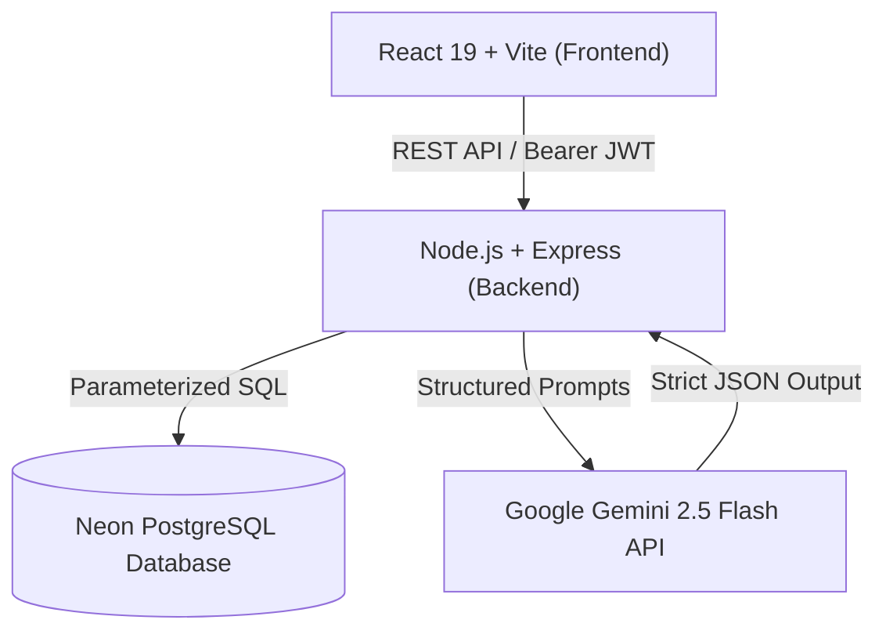

# 💰 AI-Powered Expense Tracker (PERN Stack + Gemini AI)

A full-stack, enterprise-grade personal finance application built with the **PERN stack** (PostgreSQL, Express.js, React, Node.js) and powered by **Google Gemini 2.5 Flash**.

Track expenses, manage category-wise budgets, visualize trends with dynamic charts, and receive actionable, personalized financial advice, anomaly detection, and budget alerts generated by artificial intelligence.

---

## 🌟 Key Features

- **🔐 Secure Authentication**: JWT-based authentication with bcrypt password hashing and 7-day token persistence.
- **📊 Real-time Dashboard**: Instant overview of current month income, expenses, net balance, savings rate, and month-over-month deltas.
- **💸 Transaction Management**: Full CRUD operations for income and expense transactions with search, date filters, and category tagging.
- **🎯 Dynamic Budgets**: Track category budgets on monthly or weekly cycles with live progress bars and pacing warnings.
- **🤖 Gemini AI Insights Engine**:
  - **Monthly Financial Health**: Generates an overall financial score (0-100), highlights, concerns, and 3 actionable recommendations.
  - **Savings Tips**: Analyzes top expense categories to provide ranked monthly savings recommendations.
  - **Spending Pattern Analysis**: Evaluates recent transactions to spot anomalies, impulse spikes, and recurring bills.
  - **Budget Alerts**: Real-time pacing alerts predicting if and when you'll exceed a budget limit based on days elapsed.
  - **Historical AI Archive**: All generated summaries and tips are persisted in the PostgreSQL `ai_insights` table.

---

## 🏗️ Architecture & Tech Stack



### Backend
- **Runtime**: Node.js (ES Modules)
- **Framework**: Express.js
- **Database**: PostgreSQL (Neon Serverless Postgres via `pg` connection pool)
- **Authentication**: JSON Web Tokens (`jsonwebtoken`), `bcrypt`
- **AI SDK**: `@google/genai` (Gemini 2.5 Flash)

### Frontend
- **Framework**: React 19 + Vite
- **Styling**: TailwindCSS v4
- **Routing**: React Router DOM v7
- **Icons**: Lucide React
- **Notifications**: React Hot Toast
- **Data Visualization**: Recharts

---

## 📂 Project Directory Structure

```text
AI-Expense-Tracker/
├── Backend/
│   ├── controllers/
│   │   ├── authControllers.js          # User registration, login, profile
│   │   ├── budgetsControllers.js       # Budget CRUD & spend calculations
│   │   ├── categoriesControllers.js    # Category CRUD
│   │   ├── dashboardControllers.js     # Summaries, trends, breakdowns
│   │   ├── insightsControllers.js      # Gemini AI controllers & data formatters
│   │   └── TransactionsControllers.js  # Transaction CRUD & filters
│   ├── middleware/
│   │   └── authMiddleware.js           # JWT Bearer token protection
│   ├── routes/
│   │   ├── authRoutes.js
│   │   ├── budgetsRoutes.js
│   │   ├── categoriesRoutes.js
│   │   ├── dashboardRoutes.js
│   │   ├── insightsRoutes.js
│   │   └── transactionRoutes.js
│   ├── scripts/
│   │   └── migrate.js                  # Database schema runner
│   ├── sql/
│   │   └── schema.sql                  # PostgreSQL DDL
│   ├── utils/
│   │   ├── defaultCategories.js        # Default seed categories
│   │   └── gemini.js                   # Gemini 2.5 Flash prompt engine
│   ├── db.js                           # Neon Pool connection
│   ├── server.js                       # Express app entry point
│   ├── .env.example
│   └── package.json
│
├── Frontend/
│   ├── src/
│   │   ├── components/                 # Modals, Navbar, Sidebar, InsightCards
│   │   ├── pages/                      # Dashboard, Transactions, Budgets, Insights
│   │   ├── lib/axios.js                # Unified Axios client (Real API + Mock fallback)
│   │   ├── utils/                      # Formats, API paths, mock data
│   │   ├── App.jsx
│   │   └── main.jsx
│   ├── .env.example
│   ├── vite.config.js
│   └── package.json
│
└── README.md
```

---

## 🗄️ Database Schema

The database consists of 5 core tables defined in `Backend/sql/schema.sql`:

1. **`users`**: User identity, hashed passwords, and default currency (`INR`, `USD`, `EUR`, etc.).
2. **`categories`**: User-defined and default categories (type: `income` | `expense`).
3. **`transactions`**: Financial records with amount, date, description, type, and category foreign key.
4. **`budgets`**: Limit amount, period (`monthly` | `weekly`), and category link.
5. **`ai_insights`**: Stores generated Gemini summaries and savings tips as `JSONB` for quick historical retrieval.

---

## 🚀 Getting Started

### 1. Prerequisites
- **Node.js**: v18.0.0 or higher
- **PostgreSQL**: Neon cloud instance or local PostgreSQL 14+
- **Gemini API Key**: From [Google AI Studio](https://aistudio.google.com/)

---

### 2. Backend Setup

1. Open a terminal and navigate to the `Backend` directory:
   ```bash
   cd Backend
   ```

2. Install dependencies:
   ```bash
   npm install
   ```

3. Configure environment variables:
   Create a `.env` file inside `Backend/`:
   ```env
   PORT=3000
   DB_URL=postgresql://<username>:<password>@<host>/<database>?sslmode=require
   JWT_TOKEN=your_strong_jwt_secret_key
   Gemini_API_Key=your_gemini_api_key
   ```
   *(Reference available in `Backend/.env.example`)*

4. Run database migrations to create all tables and indexes:
   ```bash
   npm run migrate
   ```
   *Optional: To reset and recreate tables from scratch, run:*
   ```bash
   npm run migrate:reset
   ```

5. Start the backend server:
   ```bash
   npm run dev
   ```
   The backend will be running at `http://localhost:3000`.

---

### 3. Frontend Setup

1. Open a separate terminal and navigate to the `Frontend` directory:
   ```bash
   cd Frontend
   ```

2. Install dependencies:
   ```bash
   npm install
   ```

3. Configure environment variables:
   Create a `.env` file inside `Frontend/`:
   ```env
   VITE_API_URL=http://localhost:3000/api
   VITE_USE_MOCK=false
   ```

4. Start the frontend development server:
   ```bash
   npm run dev
   ```
   Open your browser and navigate to `http://localhost:5173`.

---

## 📡 API Endpoints Reference

All `/api/*` routes (except `/api/auth/register` and `/api/auth/login`) require the following header:
```http
Authorization: Bearer <your_jwt_token>
```

### 1. Authentication (`/api/auth`)
| Method | Endpoint | Description |
| :--- | :--- | :--- |
| `POST` | `/api/auth/register` | Register user and initialize default categories |
| `POST` | `/api/auth/login` | Authenticate user and receive JWT token |
| `GET` | `/api/auth/me` | Fetch authenticated user profile |

### 2. AI Insights (`/api/insights`)
| Method | Endpoint | Description |
| :--- | :--- | :--- |
| `GET` | `/api/insights/monthly` | Full AI financial health report, recommendations, and health score (0-100) |
| `GET` | `/api/insights/budgets` | AI evaluation of all budgets (overspent, at-risk, and healthy categories) |
| `GET` | `/api/insights/savings-tips` | Personalized, ranked tips to cut spending in top expense categories |
| `GET` | `/api/insights/transactions` | Pattern recognition and anomaly detection across latest 100 transactions |
| `GET` | `/api/insights/budget-alert/:id`| Pacing and burn-rate alert for a specific budget item |
| `GET` | `/api/insights` | Retrieve up to 50 previously saved AI insights from the archive |
| `POST` | `/api/insights/generate` | Trigger on-demand generation (`{ "type": "monthly_summary" \| "savings_tips" }`) |

### 3. Dashboard (`/api/dashboard`)
| Method | Endpoint | Description |
| :--- | :--- | :--- |
| `GET` | `/api/dashboard/summary` | Current month totals, balance, savings rate, and deltas |
| `GET` | `/api/dashboard/category-breakdown` | Category-wise expense breakdown for current month |
| `GET` | `/api/dashboard/monthly-trend` | 6-month historical income vs expense trend |

### 4. Transactions (`/api/transactions`)
| Method | Endpoint | Description |
| :--- | :--- | :--- |
| `GET` | `/api/transactions` | Query transactions (filters: `type`, `categoryId`, `startDate`, `endDate`, `search`, `limit`, `offset`) |
| `POST` | `/api/transactions` | Create a new transaction |
| `GET` | `/api/transactions/:id` | Get single transaction |
| `PATCH` | `/api/transactions/:id` | Update transaction |
| `DELETE` | `/api/transactions/:id` | Delete transaction |
| `POST` | `/api/transactions/analyze` | Run AI analysis on selected transactions |

### 5. Budgets (`/api/budgets`)
| Method | Endpoint | Description |
| :--- | :--- | :--- |
| `GET` | `/api/budgets` | Fetch all user budgets with live spent amount calculated |
| `POST` | `/api/budgets` | Create a new category budget |
| `PATCH` | `/api/budgets/:id` | Update budget amount or period |
| `DELETE` | `/api/budgets/:id` | Delete budget |
| `POST` | `/api/budgets/analyze` | Run AI analysis across all current budgets |

### 6. Categories (`/api/categories`)
| Method | Endpoint | Description |
| :--- | :--- | :--- |
| `GET` | `/api/categories` | List all user categories (income & expense) |
| `POST` | `/api/categories` | Create custom category |
| `PATCH` | `/api/categories/:id` | Update category name, icon, or color |
| `DELETE` | `/api/categories/:id` | Delete custom category |

---

## 🧪 Testing with Postman or cURL

### Quick Flow Example:
1. **Register**:
   ```bash
   curl -X POST http://localhost:3000/api/auth/register \
     -H "Content-Type: application/json" \
     -d '{"name": "Jane Doe", "email": "jane@example.com", "password": "password123", "currency": "USD"}'
   ```
2. **Copy the returned `token`** and test the AI Monthly Insight:
   ```bash
   curl -X GET http://localhost:3000/api/insights/monthly \
     -H "Authorization: Bearer <YOUR_TOKEN>"
   ```

---

## 🛡️ Security & Best Practices
- **No Client User ID Acceptance**: All queries strictly derive user ownership from the verified JWT payload (`req.userId`).
- **Input Sanitization**: Numeric casting, regex filtering, and parameterized SQL queries protect against SQL injection.
- **Fail-Safe AI Calls**: Default fallbacks prevent wasted Gemini token costs when users have no recorded activity.
- **Error Privacy**: Server error details and stack traces are suppressed in API responses to protect internal infrastructure details.

---

## 📄 License
This project is open-source and available under the [MIT License](LICENSE).
